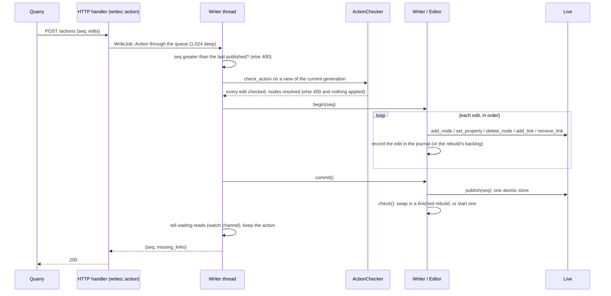

# The kinetic layer: applying actions

_State as built, 2026-11-23, on master (0.1.2). The kinetic layer (`src/kinetic/`) lays Quarry's actions on top of the
packed graph without changing it, so searches never wait for a write and never see half an action. The HTTP side is
`src/bin/server/writes.rs`, `check.rs` and `reload.rs`. How the packed graph itself is stored:
[how-it-works.md](how-it-works.md)._


## 1. In one example

The graph has one node type, **User** (primary key `nodeId`; properties `status` and others), and one link type,
**FOLLOWS** (User → User). Three users are loaded from the datasets, and the last action applied was 1234:

| User | status | follows |
|---|---|---|
| ana | active | ben |
| ben | active | |
| cleo | inactive | |

Quarry sends action 1235: dan joins, follows ana, and ana becomes inactive.

```http
POST /actions
content-type: application/json

{"seq": 1235,
 "edits": [
   {"op": "add_node", "type": "User", "key": "dan", "properties": {"status": "active"}},
   {"op": "add_link", "link_type": "FOLLOWS", "from": {"type": "User", "key": "dan"}, "to": {"type": "User", "key": "ana"}},
   {"op": "set_property", "node": {"type": "User", "key": "ana"}, "property": "status", "value": "inactive"}
 ]}
```

```json
{"seq": 1235, "missing_links": 0}
```

After the call:

| Where | What changed |
|---|---|
| the packed graph (`storage::Graph`) | **nothing**: its arrays never change |
| `Live::new_nodes`, `new_seqs`, `new_by_type` | dan: node number 3 (after the 3 packed users), added by action 1235 |
| `Live::new_keys` | (User, "dan") → node 3 |
| the side store, FOLLOWS forward | under dan: an entry → ana, action 1235 |
| the side store, FOLLOWS backward | under ana: an entry → dan, action 1235 |
| `Live::changed` | the bits of dan and ana: walks now read their side-store entries |
| the property log of User.status | (ana, "inactive", action 1235) |
| `Live::published` | 1234 → 1235 |
| the writer's journal | the three edits, each with 1235, for the next rebuild |
| the server's kept actions | the whole action, for replay after a reload |

A search that started before the publish still sees action 1234: three users, ana active. One that starts after sees
1235. No search sees dan without his link, or his link with ana still active.


## 2. What you need to send an action

1. **The server running** with a schema and datasets ([HTTP API](http-api.md#running-it)).
2. **A sequence number greater than the last one applied.** It's Quarry's number for the action; gaps are fine, going
   back is a 400. `GET /health` returns the last one.
3. **Nodes named by type and primary key.** An edit may name a node an earlier edit of the same action adds, like dan
   above.
4. **Properties the schema lists.** Only those are held; any other is an error.


## 3. The pieces

| Piece | File | What it is |
|---|---|---|
| `Store` | `kinetic/store.rs:45` | the current generation, and the writer's state while no writer is out |
| `Writer` | `kinetic/store.rs:151` | the only way to write; there is one at a time. Journals each edit and runs rebuilds |
| `Editor` | `kinetic/editor.rs:23` | applies edits to one generation: numbers new nodes and links, fills the structures below |
| `Generation` | `kinetic/live.rs:75` | one packed graph plus `Live`, the edits made on it since it was built |
| `Live` | `kinetic/live.rs:52` | the edits, beside the packed arrays, and the last published action |
| `View` | `kinetic/live.rs:340` | what a search reads: a generation as of one published action (`upto`) |

Inside `Live`, one structure per kind of edit:

| Edit | Structure | Carries the action's number |
|---|---|---|
| node added | `new_nodes` (type and position), `new_seqs`, `new_by_type`, `new_keys` | yes |
| link added | the side store (`kinetic/side.rs`): per link type and direction, chunks of 8 entries per node | yes |
| link removed, if it was added since the rebuild | its side-store entry gets a removal number | yes |
| link removed, if it was packed | a bit in `removed`, one per packed position | **no** |
| node deleted | a bit in `deleted` | **no** |
| property set | the property's log (`kinetic/changes.rs`): (position, value, action) | yes |

Edits carrying the action's number are invisible to views pinned before it. The two without one can be seen by a search
already running, before the rest of their action: see §8.


## 4. The code, step by step



1. **`writes::action`** (`bin/server/writes.rs:41`): the route `POST /actions`. It sends a `WriteJob::Action`
   (`state.rs:21`) to the writer thread and waits for its reply. A full queue makes the request wait; a stopped writer
   is a 503.
2. **`writer_thread`** (`writes.rs:63`): one thread, started at launch (`main.rs:127`), takes jobs one at a time. With
   none for 50 ms it calls `Writer::idle`, which swaps in a finished rebuild.
3. **`apply`** (`writes.rs:200`):
   1. Refuses a sequence number not greater than the last published one.
   2. **`check_action`** (`check.rs:228`) reads a view of the current generation and checks every edit before any is
      applied: types, properties and values exist and fit, named nodes exist (or an earlier edit adds them), keys
      aren't empty, a node isn't added twice. `ActionChecker` (`check.rs:242`) tracks the nodes earlier edits added or
      deleted, so "delete ana, add ana again" in one action works. Any problem: a 400, and nothing is applied.
   3. `writer.begin(seq)`, then each checked edit through the `Writer` (`store.rs:315` to `:394`), which journals it
      (`record`, `store.rs:394`) and hands it to the `Editor`:

      | Edit | `Editor` method | What it writes |
      |---|---|---|
      | add node | `add_node` (`editor.rs:111`) | the next node number; type, position, key and action in `Live` |
      | set property | `set_property` (`editor.rs:131`) | a `Change` in the property's log |
      | delete node | `delete_node` (`editor.rs:146`) | the node's deleted bit |
      | add link | `add_link` (`editor.rs:152`) | an entry in both directions' side stores; both ends marked changed |
      | remove link | `remove_link` (`editor.rs:196`) | the packed position's removed bit, or the side-store entry's removal number |

   4. `writer.commit()` (`store.rs:200`): **`Live::publish`** (`live.rs:259`) stores the sequence number, the one
      moment the whole action becomes visible. Then `check` (`store.rs:213`) swaps in a finished rebuild, or starts one
      if the edits passed the limit (§6).
4. **`WriterThread::action`** (`writes.rs:123`): tells reads waiting on `after` that the action is in, and keeps it
   (`keep`, `writes.rs:134`; the last 1,000,000) for replay after a reload (§7).


## 5. Reads

1. **`wait_for`** (`state.rs:93`): with `after: N`, the read waits until action N is published, up to 10 s (else
   504). This is read-your-writes: send an action, get its `seq` back, pass it as `after`.
2. **`on_pool`** (`state.rs:69`): the read takes one of the read slots (one per core) and runs on the rayon pool.
3. **`Generation::view`** (`live.rs:90`, `Live::view` at `:152`): reads `published` once, as `upto`. The node count
   comes from it too (`new_nodes_upto`, a binary search over `new_seqs`), so a view can't count a node its action
   hasn't published.
4. **The walk** reads through the view. For each node it looks at the packed row; only if the node's changed bit is set
   (`View::for_each`, `live.rs:442`) does it skip removed packed links and add side-store entries with
   `seq <= upto` (`side.rs:140`). Property conditions apply logged changes with `seq <= upto` (`condition.rs:394`).
5. The answer carries `seq`: the `upto` it read.

Reads never take the writer's lock. Looking up a key added since the rebuild takes a short read lock on `new_keys`.


## 6. Rebuilds

The side store and logs grow with every action, and walks slow down on changed nodes. A rebuild folds them into a new
packed graph.

1. **When:** `check` (`store.rs:213`) after each commit and when idle. The limit is 5% of the packed links or nodes,
   at least 1,000 edits (`set_limits`, `store.rs:491`).
2. **`start_rebuild`** (`store.rs:409`): takes the journal, notes the last published action, and starts a thread
   running **`build_and_catch_up`** (`store.rs:528`):
   1. **`rebuild::rebuild`** (`rebuild.rs:67`): a new packed graph from the old one plus the journal. Deleted nodes
      are dropped, added nodes join their type, links and properties are merged, and every node is renumbered in
      breadth-first order. It also returns `remap`, old node number → new one.
   2. A new generation as of that action, and a `Replay` (`store.rs:587`) onto it.
   3. **Catch-up in rounds:** meanwhile the writer keeps applying actions to the old generation and puts each edit in
      the rebuild's backlog instead of the journal. The thread takes the backlog, replays it onto the new generation
      with node numbers translated through `remap`, and repeats until a round finds fewer than 1,000 edits.
3. **`swap`** (`store.rs:427`), between two actions: the writer replays what's left of the backlog itself, publishes
   at least the old generation's last action, and makes the new generation current. That pause is well under a
   millisecond.

Searches already running finish on the old generation, which is freed when the last one ends. While a rebuild runs,
memory holds both: about twice the packed graph.


## 7. Reloads

When Quarry's sync rewrites the datasets, `POST /reload {"as_of_seq": N}` loads them all again. N is the last action the
datasets already hold.

1. **`reload::reload`** (`bin/server/reload.rs:49`): one at a time (409 if one is running). It runs in its own task,
   so a client that stops waiting doesn't stop it halfway.
2. **`reload_and_swap`** (`reload.rs:89`): reads the schema file again and loads every dataset on a blocking thread,
   while searches and actions carry on against the current graph. A load that fails is a 422.
3. A `WriteJob::Swap` to the writer thread, which runs **`WriterThread::swap`** (`writes.rs:147`):
   1. Refuses N older than the actions it still keeps (409).
   2. **`Writer::replace`** (`store.rs:270`): the new graph becomes the writer's generation, as of N. A running rebuild
      is dropped, and no new one starts until step 5.
   3. Applies again every kept action after N. One that no longer fits the new data, like a link to a node the
      datasets dropped, is listed in `failed` and skipped.
   4. `include_up_to` (`store.rs:292`): never answers with a lower number than before the reload.
   5. **`make_current`** (`store.rs:298`): searches move to the new graph.

Searches see the old graph until step 5, then the new one with every action applied: the data never goes back in time.


## 8. Guarantees and their limits

| Guarantee | Holds because |
|---|---|
| a search never waits for a write | reads use their own view; only the writer writes |
| one action at a time, in sequence order | one writer thread, and each number must be greater than the last |
| an action is all or nothing | every edit is checked before any is applied |
| a search sees no part of an action it started before | everything carrying a number is hidden past `upto` |
| a search never goes back in time | `published` only grows, across rebuilds and reloads |

Two kinds of edit carry no number: **deleted nodes** and **removed packed links**. They're bits set at once, so a
search already running may see one before the rest of its action is published.


## 9. Not built yet

| Missing | So today |
|---|---|
| Quarry's numbering | Quarry numbers an action once **per object type** (`holocron.edit_counter`); ProximaDB expects one number per action, growing across all types, and one `as_of_seq` for every dataset |
| Persistence | everything since the last load is in memory; after a restart Quarry must reload or send the actions again |
| A starting point after a restart | the loaded data counts as action 0, so a reload can't tell that actions from before the restart are missing |
| Batches | one action per request |
| Reloading one type | a reload loads every dataset |
| Numbers on deletes and packed link removals | a running search may see them early (§8) |
